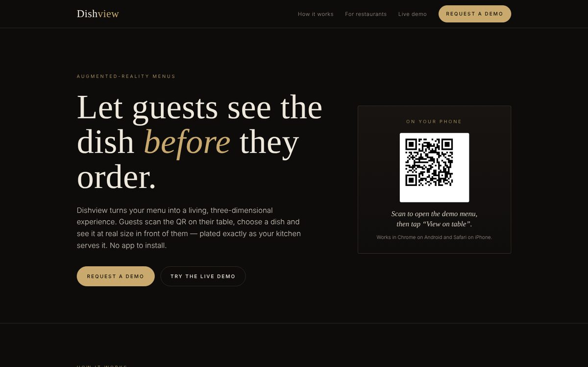
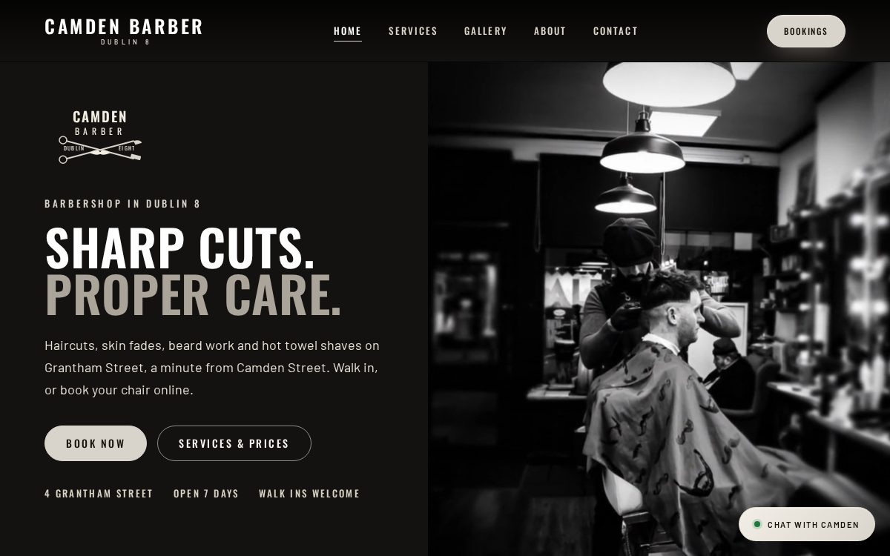
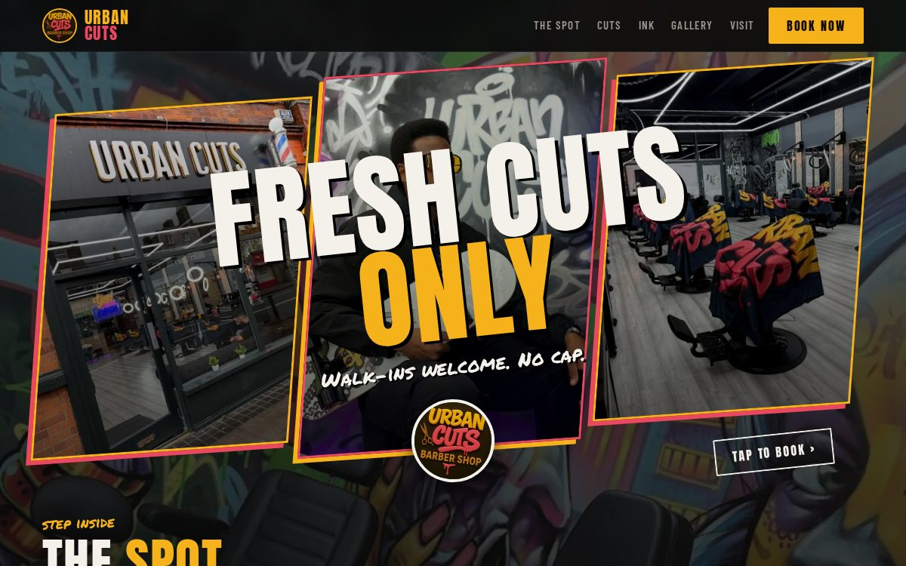
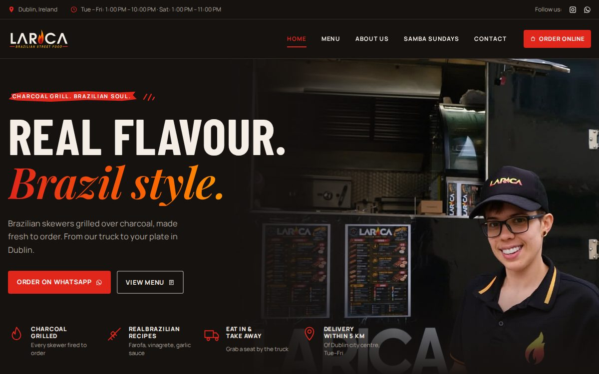
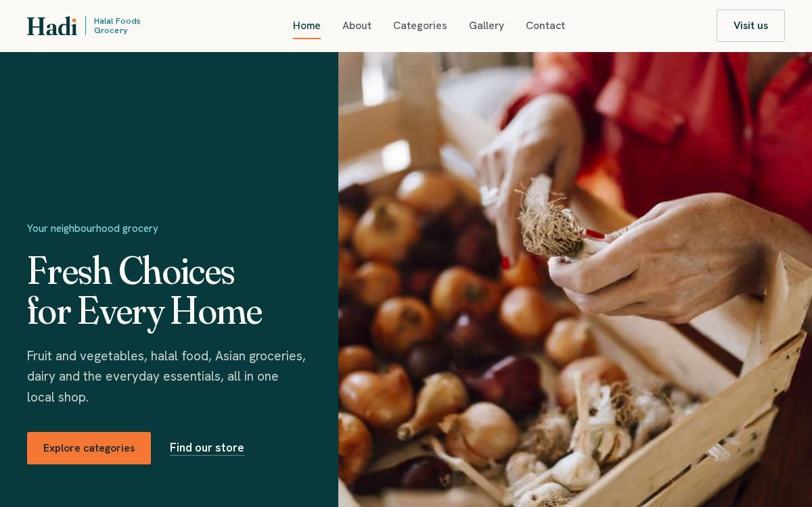
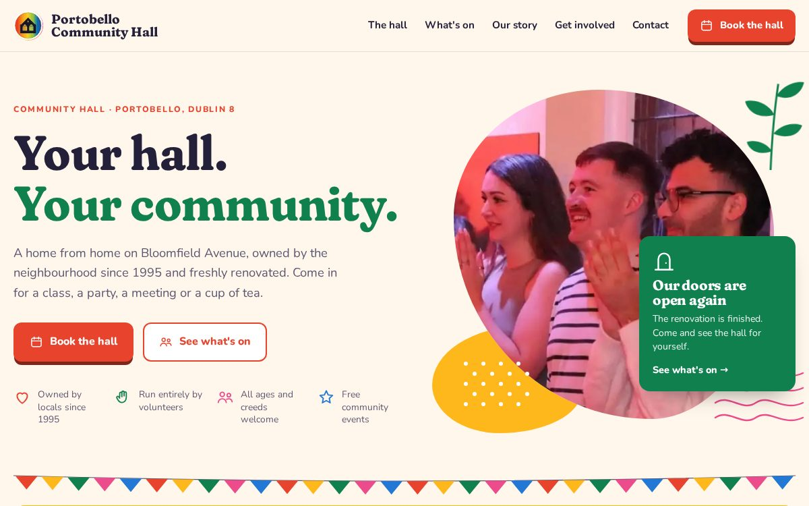
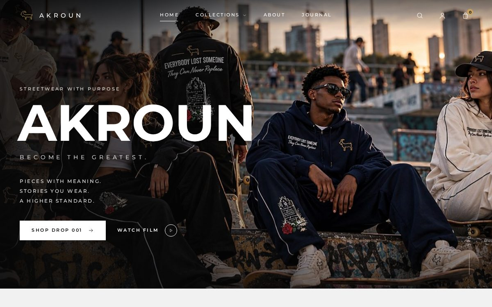

# Selected Work

**Pedro Silva · Founder of [Silva Solutions Ltd](https://www.silvasolutions.ie) · Dublin, Ireland**

Websites, web apps and software products designed, built and deployed for real businesses. 
Click any project to open the live site.

---

## Products

<table>
<tr>
<td width="50%" valign="top">

### Silva Solutions Ltd
Company website for an Irish IT and software company: services, IT support plans and a project enquiry form that goes straight to the team.

`HTML` `CSS` `JavaScript` `Serverless API` `Vercel` 
**→ [silvasolutions.ie](https://www.silvasolutions.ie)**
</td>
<td width="50%" valign="top">

### Dishview
Augmented-reality menus for restaurants. Guests scan the table QR and see each dish in 3D, at real size, on their own table. No app to install. Restaurants manage dishes, prices and allergens from their own admin page.

`WebXR / AR` `3D models` `JavaScript` `Serverless API` `Vercel Blob` 
**→ [Live demo](https://dishview-menu.vercel.app)**
</td>
</tr>
</table>

**Also in development:** Silvix (AI-powered CCTV monitoring and fleet tracking) · STRAVIQ (project intelligence) · [Silva Signage Network](https://silva-signage.vercel.app) (Smart TV advertising for local businesses) · Silva Command Center (internal operations platform)

---

## Client websites

<table>
<tr>
<td width="50%" valign="top">

### Camden Barber · Dublin 8
Barbershop website with services, gallery, online booking and opening hours. Live on its own domain.

`HTML` `CSS` `JavaScript` · **→ [camdenbarber.ie](https://www.camdenbarber.ie)**
</td>
<td width="50%" valign="top">

### Urban Cuts Barber Shop
Bold street-style barbershop site: fades, beards, ink and lounge, with walk-ins and booking.

`HTML` `CSS` `JavaScript` · **→ [Visit site](https://urban-cuts-website.vercel.app)**
</td>
</tr>
<tr>
<td width="50%" valign="top">

### Larica Street Food
Brazilian BBQ food truck in Dublin: menu, Samba Sundays and ordering via WhatsApp.

`HTML` `CSS` `JavaScript` · **→ [Visit site](https://larica-website.vercel.app)**
</td>
<td width="50%" valign="top">

### Hadi Halal Foods
Neighbourhood grocery with product categories, gallery and store location.

`Next.js` `React` `TypeScript` `Tailwind CSS` · **→ [Visit site](https://hadi-halal-foods.vercel.app)**
</td>
</tr>
<tr>
<td width="50%" valign="top">

### Portobello Community Hall
Rebuild of a volunteer-run community hall's website: events, hall bookings and how to get involved.

`HTML` `CSS` `JavaScript` · **→ [Visit site](https://portobello-community-hall.vercel.app)**
</td>
<td width="50%" valign="top">

### AKROUN
Streetwear brand website with collections, lookbook imagery and brand film.

`HTML` `CSS` `JavaScript` · **→ [Visit site](https://akroun.vercel.app)**
</td>
</tr>
</table>

**Also:** [ASTUT Tech Academy](https://astut-tech-academy.vercel.app), a tech training academy in Dublin with a career path into a paid internship

---

## What I deliver

| | |
|---|---|
| **Websites** | Fast, mobile-first sites for local businesses: design, build, hosting and domain |
| **Web apps** | Booking, ordering, admin dashboards and customer portals |
| **IT support** | Ongoing support and maintenance contracts for businesses across Ireland |
| **Software products** | AR, AI and SaaS products built and run in-house |

**Have a project in mind? → [silvasolutions.ie/contact](https://www.silvasolutions.ie/contact)**

Source code for client projects stays private. Screenshots and links are taken from the public live sites. <!--updated-->Screenshots updated automatically · last refresh 28 November 2026<!--/updated-->

